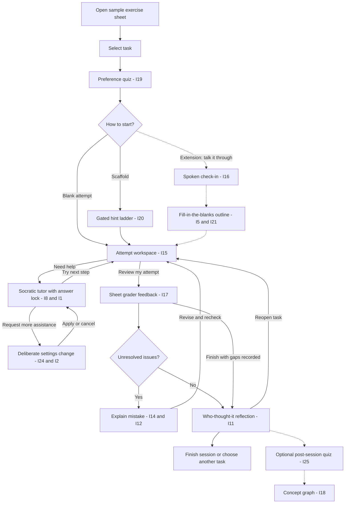

# Prototype 1: Attempt-first tutor

**Milestone:** Lo-Fi prototype · **Status:** Architecture draft · **Updated:** 19 October 2026

We are building a prototype web app for a Human Computer Interaction course. The goal is a visually polished, interactive demo that demonstrates thoughtful human-computer interaction and UI/UX best practices through clear flows, a clean interface, accessible components, and smooth, purposeful transitions. Use Nuxt and shadcn/vue to deliver a cohesive frontend experience, with scripted content and temporary UI state wherever interaction is needed. Agents working on this prototype should prioritize the quality of the demonstrated experience and keep scope focused on these flows, without building real product functionality or unnecessary features.

This document defines the prototype's purpose, app structure, user flows, and interaction rules. It is the shared reference for building a coherent, interactive demonstration. Visual styling, screen layouts, detailed component selection, and implementation tasks belong to later work.

## 1. Product intent

The student solves an exercise themselves, with an AI tutor available to help them move forward without taking over the reasoning. The app brings together an exercise, the student's working, incremental assistance, feedback, and reflection on where ideas came from.

The central loop is:

**Attempt → ask for targeted help when needed → continue working → review the attempt → explain and revise mistakes → reflect.**

The prototype should make it easy to understand what to do next, what assistance is available, and what remains the student's responsibility. Its professional feel should come from consistent structure, complete interactions, preserved context, and clear transitions. This brief leaves the visual treatment open.

### Grounding in the needfinding

The report identifies five key needs. These are research findings; the flows below are proposed responses to them, rather than validated evidence of improved learning.

| Research need | Consequence for the prototype |
| --- | --- |
| N1. Productive friction during problem-solving | Invite a contribution before giving help; make increased assistance deliberate. |
| N2. Visibility of the learner's own reasoning versus AI-supplied reasoning | Connect the final reflection to specific steps and assistance received. |
| N3. Own-attempt-first interaction by default | Begin with the student's work or point of confusion, without requiring repeated instructions to the tutor. |
| N4. Incremental, adaptive scaffolding | Offer questions and limited hints in stages, with a return to independent work between them. |
| N5. Verification and optional self-testing | Provide feedback and revision in the core flow; leave an independent recall quiz as an optional extension. |

The personas suggest different entry needs: Lukas values autonomy and concise critique; Mia welcomes practice and structured support; Wei needs a bounded starting point without an expanding chain of explanations. They use the same workspace with different assistance preferences, rather than separate products.

The report also records a tension between strict guidance and learner autonomy. The prototype should make its boundaries understandable and allow students to leave a task unfinished. Attribution of contributions must not be presented as a measurement of understanding.

## 2. Prototype contract

“Interact with everything, without functionality” means a **clickable prototype with local interaction state and scripted content**. Inputs, navigation, panels, choices, and transitions respond; AI reasoning and product services are simulated.

| The student can experience | What the prototype simulates |
| --- | --- |
| Open a sample exercise sheet and choose a task | A small, predefined exercise set replaces document processing. |
| Set assistance preferences and change them deliberately | Choices update the visible session rules and available scripted assistance. |
| Type an attempt or choose an upload interaction | Typed work stays visible; uploads use a clearly identified sample preview. No OCR or file analysis is required. |
| Request guidance and progress through a hint ladder | Prepared responses and local gates replace an AI tutor. |
| Submit work, inspect feedback, explain a mistake, and revise | Prepared review outcomes replace real grading. |
| Inspect a “Who thought it?” summary | A prepared contribution history replaces automatic attribution. |

All displayed outcomes must be consistent with the current demo scenario. Arbitrary student input must not appear to have been meaningfully graded or interpreted. Introduce the demonstration's sample-content boundary before testing, and identify simulated outcomes where needed without filling every screen with implementation details.

No backend, real model calls, accounts, database, OCR, speech recognition, automatic grading, or cross-session learning history is needed for this milestone. Temporary local UI state is enough to make the flows work.

## 3. Scope and interpretation of the source material

The flow diagram is the starting point for the journey. The component diagram explains the responsibilities behind it. Its “services” and “data” are conceptual responsibilities for this milestone, represented through prepared content and temporary session state.

The written concept and diagrams differ in a few places. The following working assumptions make this draft coherent and remain open to revision:

- **Help-setting changes are core.** I24 is described in the written MVP and shown as a solid component, although its flow-diagram branch is dashed.
- **Mistake recovery is core.** I14 and a simple, within-task repeat-mistake state from I12 support the solid feedback loop. Rich mistake detection remains simulated.
- **Final answers remain locked in the core prototype.** I1's idea-table description mentions an explicit unlock, but the written MVP and flow emphasize an answer-locked tutor. Increasing assistance therefore means more guidance, without revealing the completed solution. A full-solution opt-out is a later scope decision informed by the autonomy tension in the report.
- **Each task has its own session context.** Returning between setup, working, feedback, and reflection preserves that task's state. Starting another task begins a fresh session; there is no course-wide memory.

### Core interactive journey

| Capability | Idea IDs | Role |
| --- | --- | --- |
| Open a sample sheet and select a task | Entry to I15 | Establish what the student will work on. |
| Preference quiz | I19 | Set the assistance agreement before work starts. |
| Blank or scaffolded start | I15, I20 | Give the student a choice of starting support. |
| Attempt workspace with typed or sample-upload input | I15 | Keep the student's work central. |
| Optional Socratic tutor with answer lock | I8, I1 | Address a specific difficulty without completing the task. |
| Gated, limited hints | I20 | Provide incremental support with student contributions between stages. |
| Deliberate assistance change | I24; basic level choice from I2 | Let the student reconsider the assistance agreement. The slider form is optional. |
| Sheet grader and feedback | I17 | Review a submitted attempt. |
| Explain, revise, and recheck | I14, simple I12 | Close the loop on an identified mistake. |
| Contribution sidebar and final summary | I11 | Make the origin of visible reasoning inspectable. |

### Extensions with defined attachment points

| Extension | Idea IDs | Where it joins the journey |
| --- | --- | --- |
| Spoken check-in → fill-in-the-blanks outline; adjustable granularity | I16, I5, I21 | A third starting path before entering the same workspace. |
| More detailed assistance control | I2 | The existing preferences and assistance-change flow. |
| Strict-TA critique | I3 | Additional depth within feedback, before revision. |
| Lecture material | I23 | Optional contextual material inside the workspace. |
| Independent post-session quiz | I25 | After reflection, with an explicit choice to participate. |
| Concept graph and recall of a past problem | I18, I29 | A later layer connecting completed task sessions. |

Other ideas remain outside the current flow: planted mistakes (I4), twin problems (I6), abstraction ladder (I7), hidden-chat explain-back (I9), understanding traffic lights (I10), confidence and skip override (I13), diagnostic quizzes (I22), exam-aware repetition (I26), defending a solution (I27), weekly review (I28), and personal summaries or points (I30). Their inclusion in the ideation report does not make them prototype requirements.

Extensions should appear as interactive flows only when the team chooses to prototype them. The core journey should stand on its own.

## 4. App structure

There are five main app destinations. Assistance, hints, settings, and mistake explanation are contextual states within the task journey, rather than separate top-level destinations.

```text
Exercise entry
└── Open sample sheet / choose task
    └── Session setup
        ├── Assistance preferences
        └── Starting approach
            ├── Blank attempt
            ├── Guided scaffold
            └── Spoken check-in → outline [extension]
                ↓
            Task workspace
            ├── Exercise context
            ├── Student attempt
            ├── Optional tutor and hint ladder
            ├── Assistance agreement and changes
            └── Contribution history
                ↓
            Review and feedback
            ├── Explain mistake → revise in workspace → recheck
            └── Finish review
                ↓
            Session reflection
            ├── Inspect “Who thought it?” summary
            ├── Reopen current task
            ├── Finish / choose another task
            └── Optional quiz → concept graph [extensions]
```

The scaffold and blank-start paths converge on the same workspace. A scaffold supplies prompts for the student to work through; it does not create a separate problem-solving product.

### Destination responsibilities

| Destination | Student's question | Essential content | Main onward action |
| --- | --- | --- | --- |
| Exercise entry | “What am I working on?” | Sample sheet, task choices, brief context | Open selected task |
| Session setup | “How should the tutor help me?” | Preference choices, assistance summary, starting approach | Start working |
| Task workspace | “What can I try next?” | Task, attempt, available guidance, current rules | Continue attempt or review it |
| Review and feedback | “Where does my reasoning hold or fail?” | Submitted attempt, linked feedback, review status | Explain and revise, or finish review |
| Session reflection | “What did I contribute, and what should I revisit?” | Contribution summary, evidence, unresolved points | Reopen task or finish session |

A marketing site, account setup, course dashboard, and settings destination are unnecessary for demonstrating this journey.

## 5. Main flow



The diagram's original “Stuck?” branch becomes two explicit student actions: ask for help or submit an attempt for review. The app does not automatically infer that the student is stuck or finished. Finishing with unresolved gaps is an added exit path so the review loop cannot trap the student.

## 6. Flow details

### F1. Open an exercise and establish the session

1. Open a provided sample sheet and select one task.
2. Confirm the task context before beginning setup.
3. Complete a short preference quiz about permitted assistance: questions only or questions with limited hints, and whether starter guidance is welcome.
4. Inspect a plain-language summary of the resulting agreement, including the answer lock and hint limit.
5. Choose a blank attempt or guided scaffold and enter the workspace.

**Rules:** Preferences apply to the current task. They describe assistance behavior, not a diagnosis of ability. The quiz has no right or wrong answers. Back navigation preserves choices. Returning from the workspace must not restart the quiz or clear the attempt.

If the student chooses a scaffold while hints are disallowed, explain the conflict and offer either a question-only starting prompt or a return to preferences. Do not silently increase assistance.

### F2. Work independently and request targeted help

1. View the selected exercise and begin an attempt by typing or attaching a sample representation of handwritten work.
2. Continue independently for as long as desired; opening the tutor is optional.
3. When needed, identify the confusing step, share current reasoning, or state what prevents a start.
4. Receive one concise question or permitted hint tied to that context.
5. Return attention to the attempt and add the next contribution.

**Rules:** The student's work remains available while help is open. A student with no starting idea can state that difficulty and receive a starter question; a blank canvas must not cause a dead end. The tutor does not insert a complete solution into the attempt. Repeated requests for the answer maintain the visible answer-lock boundary and offer a supported next action.

### F3. Use the gated hint ladder

1. Enter from the scaffold choice or open structured help while working.
2. Inspect which stage is available and how many hints remain.
3. Request an allowed hint, contribute to a development question, and complete a recall question before advancing to the next hint cycle.
4. Continue working in the same attempt between stages.

**Rules:** Later stages remain visibly unavailable until the preceding student contribution is made. In this prototype, gates check that a contribution exists; they do not claim to assess correctness. Revealing a new hint consumes one hint; rereading it does not. The budget belongs to the current task and is preserved across panel changes, revisions, and assistance changes. An increased budget requires an explicit assistance change. Exact counts are demo parameters.

When hints run out, offer continued independent work, permitted questions, review of existing guidance, or a deliberate assistance change. Do not reveal the answer as a fallback.

### F4. Change assistance deliberately

1. Open the current assistance agreement from the workspace or tutor.
2. Select a proposed change and inspect its consequences for permitted help and the hint budget.
3. If the change allows more help, pass through an explained, short pause before confirming it.
4. Apply the change or cancel and return to the previous state.

**Rules:** Selecting a setting alone does not apply it. During the pause, the student can cancel or return to their attempt. Canceling preserves the original rules and budget. Reducing assistance applies directly. Increasing it preserves the attempt, prior hints, and contribution history, and records the change in the session. The answer lock stays active. The exact pause duration and control form remain open.

### F5. Review an attempt

1. Choose “Review my attempt” from the workspace.
2. Inspect the submitted snapshot and trigger a scripted review.
3. Receive feedback tied to identifiable parts of that attempt: supported reasoning, a gap, or an error.
4. Select an issue to inspect its context and proceed to mistake explanation, or finish review if no issues remain.

**Rules:** Submission is explicit. An empty attempt explains what is needed and returns the student to working or uploading. Feedback is constructive and specific, without empty praise. Review feedback identifies a problem without completing the solution. Any displayed assessment concerns the submitted work; it does not certify mastery or represent an official course grade.

The demo must include both an “issues found” outcome and a “no issues found” outcome, selected through prepared scenarios rather than inferred from arbitrary input.

### F6. Explain, revise, and recheck

1. Open an identified issue and explain why the attempt fails at that point.
2. Submit the explanation and return to the corresponding part of the attempt.
3. Revise the work and explicitly request another review.
4. Inspect the next prepared feedback state; if the same issue recurs, see a link to its earlier explanation.
5. Continue until the issues are resolved, or finish with the unresolved gaps recorded.

**Rules:** The explanation comes before the guided revision step. Its presence advances the prototype; semantic evaluation is simulated. Students can return to inspect their work without losing the draft explanation. The student makes the correction; the tutor does not silently fix the attempt. Editing after review marks that feedback as referring to an earlier version until another review is requested.

Repeat-mistake feedback refers to this task's history and uses neutral language. “Finish with gaps” leads to reflection with those gaps visible, without marking the task as fully resolved.

### F7. Reflect on who did the thinking

1. Open the session summary after review, whether the task is resolved or unfinished.
2. Inspect which visible ideas were introduced by the student, prompted by AI, or supplied as guidance by AI.
3. Follow a contribution back to the relevant attempt step, hint, or tutor exchange.
4. Identify a point to revisit, reopen the task, finish the session, or choose another task.

**Rules:** The summary describes observable contributions and assistance received. It must not claim to know the student's internal understanding or turn authorship into a mastery percentage. Allow a mixed or unclear attribution where appropriate. Students should be able to correct an attribution they think is wrong (mine, a mix, or not sure) through a local prototype interaction, from the reflection only. Unresolved issues remain visible.

The contribution sidebar is an inspectable view of the current task; the final summary is a fuller reflection on the same history. If an optional post-session quiz is later included, declining it still completes the journey.

## 7. Component responsibilities

These are logical modules, not layout or styling prescriptions. A module may contain several UI components.

| Module | Owns | Uses or communicates with |
| --- | --- | --- |
| Exercise context | Sample sheet, selected task, problem statement | Setup, workspace, review |
| Session setup | Preference inputs, agreement summary, starting choice | Assistance policy and workspace |
| Attempt workspace | Student draft, sample attachment, revision state | Tutor context, submitted snapshot |
| Tutor panel | Help requests, concise scripted exchanges | Policy, hint ladder, contribution history |
| Hint ladder | Stages, contribution gates, revealed hints | Policy, remaining budget, attempt context |
| Assistance policy | Applied rules, answer lock, budget, pending change | Setup, tutor, ladder, change dialog |
| Review and feedback | Submitted version, prepared findings, issue selection | Attempt, mistake explanation, reflection |
| Mistake explanation | Student explanation and within-task issue history | Feedback and revision loop |
| Contribution view | Step origins and links to visible evidence | Attempt, assistance history, reflection |
| Session navigation | Current stage, return paths, finish/reset behavior | All destinations |

Only one applied assistance agreement and one hint budget exist per task. Different panels display those shared values rather than maintaining conflicting copies. The same applies to the attempt, review version, and unresolved issues.

### Minimum temporary session context

- Selected sheet and task, current journey stage, and chosen starting approach.
- Applied preferences, any pending change, and pause state.
- Current student attempt, sample attachment state, and submitted review snapshot.
- Tutor exchanges, revealed hints, ladder stage, and remaining hint budget.
- Feedback outcome, selected issue, explanation drafts, and revision status.
- Contribution entries and any attribution corrections.

This is a conceptual state inventory, not a database schema. Navigation and panel changes preserve it within the active task. Refreshing the app may restart the demonstration; durable saving and recovery are outside this milestone. Starting another task or resetting the demo discards the current task state after a clear leave/discard choice.

## 8. Interaction completeness and recovery

Every visible control needs an observable, coherent result: navigate, select, edit, reveal, collapse, confirm, cancel, or explain why an action is unavailable. Features without a prototype flow should not appear as active controls.

| Situation | Required behavior |
| --- | --- |
| Go back during setup | Preserve the selected task and preference choices. |
| Close help, settings, or an issue detail | Return to the same working context without clearing inputs. |
| Request help without an attempt | Ask for a point of confusion or offer a starter question. |
| Open a locked hint stage | Explain the preceding contribution needed to unlock it. |
| Exhaust the hint budget | Explain the boundary and show the available next steps. |
| Cancel an assistance change | Keep the applied agreement and budget unchanged. |
| Review with no attempt | Explain the missing contribution and return to the attempt. |
| Edit after feedback | Keep the feedback tied to its submitted snapshot and indicate that rechecking is needed. |
| Leave a task with unresolved issues | Offer reflection with gaps recorded or a return to revision. |
| Start another task or reset | Explain what will be discarded and allow the student to stay. |
| Encounter an optional extension | Show it only if it has a complete simulated path, or describe it outside the active journey. |

Keyboard access, visible focus, meaningful labels, and feedback conveyed through text as well as visual cues are part of interaction completeness. Transitions should help the student retain context, support reduced motion, and never be the only way to understand a state change.

## 9. Prototype guidelines — living section

Add prototype-specific rules here as the team develops the concept. Keep confirmed constraints distinct from proposals. A new rule should describe its effect on the journey and name the affected flow or module when relevant.

### Confirmed constraints from the brief

- **G01 — Framework:** Build the app with **Nuxt**.
- **G02 — Component library:** Use **shadcn/vue** for the app's components.
- **G03 — Deployment:** Deploy the prototype on **Vercel**.
- **G04 — Interaction:** Every visible interactive element must respond coherently.
- **G05 — Functionality boundary:** Use scripted content and temporary UI state to demonstrate the experience; real product services are outside this milestone.
- **G06 — Experience:** Aim for a professional, clean, learning-friendly experience with clear structure, smooth flows, and purposeful animations and transitions.
- **G07 — Document scope:** Keep this architecture focused on ideas, structure, flows, and rules. Decide visual styling and detailed implementation separately.

### Proposed operating rules in this draft

- **G08 — Student ownership:** Student contributions anchor the learning flow; assistance returns the student to their own attempt.
- **G09 — Answer boundary:** Keep final answers locked throughout the core journey, including after assistance increases.
- **G10 — Deliberate escalation:** Explain and confirm an increase in help after a short, cancelable pause. Reducing help does not require the pause.
- **G11 — Continuity:** Preserve current-task work, settings, hints, and explanations across navigation within the journey.
- **G12 — Honest reflection:** Describe contribution origins without claiming to measure understanding.
- **G13 — Learner autonomy:** Permit finishing with gaps. Keep any post-session quiz optional.
- **G14 — Scope discipline:** Add extensions through their defined attachment points; keep the core journey complete without them.
- **G15 — Prototype honesty:** Make sample uploads, prepared tutor responses, grading, and attribution understandable as simulated behavior.
- **G16 — Consistent language:** Use the same names for tasks, attempts, hints, assistance, feedback, and reflection throughout the app.
- **G17 — Purposeful friction:** Put friction around learning choices and increased assistance; keep ordinary navigation and recovery straightforward.

### Rules added when the prototype became a full app (20 October 2026)

The brief changed from "demonstrate the core journey" to "look and behave like the real product, minus the real services". These entries record what that changes. The core journey, F1–F7 and G01–G14 still hold.

- **G18 · Product framing:** the app presents itself as a finished product. No "demo", "prototype" or "scripted" labels appear in the student journey. · all screens · Confirmed
- **G19 · Supporting destinations:** destinations beyond the five journey screens now exist because a real product needs them: sign-in and onboarding, Today, Library (courses, sheets, add-sheet flow), History, Settings, and a command palette. They never gate or interrupt the journey. · Section 4 · Confirmed (replaces the statement that marketing, account, dashboard and settings destinations are unnecessary)
- **G20 · Standing defaults:** onboarding and Settings set default assistance for new tasks (N3). Each task still confirms its own agreement in setup, and the agreement stays per task. · F1, session setup · Confirmed
- **G21 · Per-task sessions persist:** leaving a task keeps its attempt, hints and tutor exchanges. They are removed only through an explicit "Discard session". Finishing archives the session to History, from where the task can be reopened. · F1, G11, Section 8 · Proposed (replaces "starting another task discards the current one")
- **G22 · Simulated services stay simulated:** uploads, handwriting reading, task detection, tutor replies, feedback and attribution use fixtures, and the review outcome is chosen from the command palette, not inferred from input. Feedback wording describes the submitted steps and never claims to grade or measure understanding. · G05, F5 · Confirmed (relaxes G15's on-screen labelling at the brief's request, keeps its honesty about what feedback means)
- **G23 · Accessible motion:** richer motion is allowed (staggered entrances, spring layout pills, labelled waits). It is removed with the OS reduced-motion setting or Settings → Appearance, and never carries state on its own. · G06, Section 8 · Confirmed
- **G24 · Sparing use of cards:** lists, timelines and rows with dividers are preferred. Raised surfaces are kept for the writing sheet and a few focused panels. · design · Confirmed
- **G25 · Honest reflection, unchanged:** counts of origins appear as plain numbers with labels, never as percentages or a score, and carry the sentence that they don't measure understanding. · G12 · Confirmed
- **G26 · Extensions remain out:** spoken check-in, strict-TA critique, lecture material, post-session quiz and concept graph are still not in the app. · G14 · Confirmed

### Rules added after the flow audit (20 October 2026)

The workspace, review and reflection were re-checked against F2, F5–F7 and N1–N4. These entries record what changed and why.

- **G27 · Help names its step:** a help request can say which step it is about (or only that the student is stuck there), and every tutor reply ends with an action that returns the student to that step in their own attempt. A reply never leaves the student in the chat. · F2, N3 · Confirmed
- **G28 · One sheet through work and review:** review shows the same writing sheet read-only, with feedback written against each step. The gap, the question and the explanation field sit on the step they refer to. · F5, F6 · Confirmed
- **G29 · Explain, then revise, in one move:** the revise action stays unavailable until the student has written an explanation; using it saves the explanation and opens the flagged step. Finishing with the gap open sits inside the gap, not in the main action bar. · F6, G17 · Confirmed
- **G30 · Revision keeps its context:** while a gap is open, the workspace shows the gap's title and the student's own explanation beside the step being revised, with a link back to the full feedback. · F6, Section 8 · Confirmed
- **G31 · Same action bar everywhere:** secondary or back on the left, the next step on the right, on the workspace and on review. The assistance level is shown once, in the session header while working. · design · Confirmed
- **G32 · Corrections instead of flags:** the in-workspace flag is removed. In the reflection, "Not quite right?" lets the student re-label one entry (mine, a mix, not sure); the counts follow the correction and a fourth count appears only when needed. This gives the mixed or unclear attribution F7 asks for. · F7, G12 · Replaces the free-text flag
- **G33 · Every contribution leads back:** from the reflection, steps open in the attempt and hints and tutor questions open the tutor panel. · F7 · Confirmed
- **G34 · Scaffold start opens the ladder:** choosing a scaffold with hints on opens the tutor panel on arrival, so the gated hint ladder is where the student lands. · F1, F3 · Confirmed

### Adding future rules

Append new entries using **ID · rule · affected flow/module · status**. Use `Confirmed`, `Proposed`, or `Replaced` as the status. If a rule changes a flow, update that flow in the same revision. Continue numbering from G35; retain earlier entries or identify the rule they replace so the team can follow changes.

## 10. Prototype walkthroughs

The architecture is covered when the team can demonstrate these journeys with prepared content. These are walkthrough criteria for this milestone, not claims that the learning approach has been validated.

| Walkthrough | Path and expected observation |
| --- | --- |
| Independent attempt | Open task → preferences → blank start → sample attempt → review with no issues → reflection. Help remains optional. |
| Supported attempt | Choose scaffold → reveal a permitted hint → contribute to the gated questions → continue in the same workspace → review. |
| Stuck before starting | Open a blank attempt → state a difficulty → receive a starter question → make a contribution. |
| Deliberate escalation | Open settings → request more help → inspect consequences → cancel; repeat and confirm after the pause. Existing work and history remain. |
| Mistake recovery | Submit prepared faulty attempt → inspect feedback → explain failure → revise → recheck → inspect reflection. |
| Repeated mistake | Recheck with the prepared repeated-error scenario → inspect the link to earlier feedback → revise again. |
| Finish with gaps | Receive feedback → choose to stop revision → inspect reflection with unresolved issues → finish. |
| Boundaries and recovery | Inspect an unavailable hint, exhaust hints, request a final answer, navigate back, reopen the task, and cancel leaving it. Each state provides a clear next action. |

Use a small, consistent fixture set covering an initial attempt, an incorrect attempt, a revision, tutor exchanges, hints, feedback, and a matching contribution history. Scenario selection for reviewers can sit outside the student journey. A summary must never reference help that was not shown in that scenario.

## 11. Sources and decisions left open

- [Needfinding report](</Users/mateimarin/ETH/Semester 5/HCI/Milestone 1 - Needfinding/Needfinding_Report_Final.pdf>): interview synthesis on page 1; personas on pages 2–4; five key needs on pages 5–7; secondary needs and reflection on pages 7–9.
- Prototype ideation and I1–I30 descriptions supplied in the request.
- [Provided flow diagram](</Users/mateimarin/ETH/Semester 5/HCI/Milestone 2 - Ideation/Lo-Fi Prototypes/Prototype 1/references/prototype-flow.png>): baseline journey and optional branches.
- [Provided component diagram](</Users/mateimarin/ETH/Semester 5/HCI/Milestone 2 - Ideation/Lo-Fi Prototypes/Prototype 1/references/prototype-components.png>): screen responsibilities and conceptual policy, grading, mistake, and attribution layers.

Before implementation, the team can choose the sample exercise, exact preference questions, assistance levels, hint count, pause duration, and which extensions to demonstrate. Visual styling, layout, detailed component choices, and animation treatment also remain open. These choices should refine the architecture without silently changing its scope.
