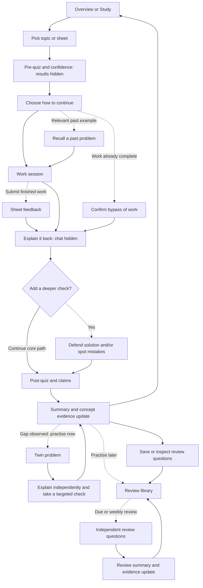

# Prove-it Companion: Prototype Architecture

We are building a visual, interactive demo web app for a Human Computer Interaction course. The goal is a polished, clean, learning-friendly frontend that demonstrates strong UI/UX practices through clear flows, intuitive interactions, consistent components, and smooth transitions. Use **Nuxt** and **shadcn/vue** to deliver this experience. Agents should prioritise interface quality and interaction coherence, implementing only the navigation and simulated states needed to demonstrate the prototype; real functionality, backend services, and unnecessary features are outside this milestone's scope.

**Course:** Human Computer Interaction, Milestone 2  
**Prototype:** 2 — Prove-it companion  
**Updated:** 22 October 2026  
**Deliverable:** An interactive web prototype with simulated learning content and outcomes.

This document defines the app's information architecture, user journeys, screen responsibilities, and interaction rules. It is a working reference for building the prototype, rather than a visual design specification or an implementation plan. Colours, typography, page layouts, branding, and detailed animation choices remain open.

The agreed scope is **a short core path with optional deeper checks**. Sections 1–12 describe the full design; **§13 records the 22 October simplification and marks what it replaces**. Every step in the supplied user-flow diagram remains reachable, without requiring every student to complete the entire sequence.

## 1. Product intent and research basis

### The central promise

Help students distinguish what they can explain or do independently from what they could follow with assistance.

The student can work efficiently with an in-app study companion or their existing tools. Afterwards, the app invites them to demonstrate their understanding with the earlier explanation hidden. The outcome is a clear account of demonstrated understanding, remaining gaps, and useful next practice.

The main experience follows four stages:

**Prepare → Work → Verify → Review**

Verification after working is the defining experience. The app should not turn every work session into a compulsory sequence of tutoring interruptions.

### What the needfinding report contributes

The [Milestone 1 needfinding report](../../../Milestone%201%20-%20Needfinding/Needfinding_Report_Final.pdf) identifies five key needs on pages 5–7. The table connects them to this prototype; the proposed responses are design hypotheses to evaluate, rather than findings already established by the interviews.

| Report need | Response in this prototype |
| --- | --- |
| 1. Productive friction that prevents confusing completion with mastery | A brief baseline check and a separate verification stage after working. |
| 2. Visibility into understanding versus following | Independent recall, pre/post comparison, and concept-level evidence. |
| 3. Opportunities for the student's own attempt | Answers and explanations are entered before feedback appears during checks. Students may also bring their own work. |
| 4. Adjustable, incremental scaffolding | Optional assistance controls within work and practice, with explicit disclosure when support affects a check. |
| 5. Post-interaction verification with learner control | A recommended core check, optional deeper checks, and deliberate skip/defer routes. |

Prototype 2 places most productive friction after the work session. It does not make an attempt-first gate or a strict hint sequence compulsory throughout solving.

The three personas on pages 2–4 suggest different routes through the same structure:

- **Lukas:** preserve control, concise feedback, and a way to move directly to verification when work is already complete.
- **Mia:** make independent practice, mistake checking, and similar problems easy to reach.
- **Wei:** show a clear next action, make priorities understandable, and avoid an endless chain of follow-up topics.

The report also records tension around enforced recall and a convenience bias in participant selection. This prototype can test whether students understand and accept the proposed flows. It cannot establish that the product improves retention or accurately measures mastery.

## 2. Prototype boundaries

### What “interactive, without functionality” means

The prototype implements the interaction layer: navigation, editable inputs, selections, expanding details, dialogs, scripted feedback, and temporary state changes. It does not implement the underlying educational services.

For example, a student can type an explanation, submit it, inspect prepared feedback, and continue to a summary. The app does not actually understand or grade that explanation.

| Included in this milestone | Simulated or outside this milestone |
| --- | --- |
| Complete journeys between all included screens | Live AI chat, generation, grading, or speech recognition |
| Entering and revising answers before submission | Reliable assessment of arbitrary typed or spoken answers |
| Local changes to filters, confidence, settings, and selected cards | Accounts, a database, or synchronisation between devices |
| Prepared examples of correct, partial, incorrect, assisted, and skipped checks | A real mastery model or validated scoring thresholds |
| An upload interaction with a sample document preview | Reading, parsing, storing, or grading uploaded files |
| A review queue that visibly responds to prototype choices | A real scheduler, notifications, or calendar integration |
| An export interaction with a preview and simulated confirmation | A working Anki integration or external export service |

Use a preloaded student workspace so the walkthrough starts with studying. Account creation and an onboarding questionnaire are outside the walkthrough.

## 3. Information architecture

### The course workspace

The app has four persistent destinations. A selected course provides the context shared across them.

| Destination | Student's question | Responsibility |
| --- | --- | --- |
| **Overview** | What should I do next? | Resume an unfinished session, start a new one, see concept status, and enter due or weekly review. |
| **Study** | What am I working on? | Choose a topic or sheet and enter a guided session. |
| **Concepts** | What have I demonstrated, and where are the gaps? | Inspect concepts and sub-concepts, the evidence behind their status, and relevant practice. |
| **Review** | What should I revisit? | Browse saved questions, take due or weekly checks, and adjust exam preparation priorities. |

Exam settings belong to the selected course and are reachable from Overview and Review. Session history belongs with its related topic or concept; it does not need a separate primary destination. General preferences are a utility, not a stage in the learning flow.

```text
Course workspace
├── Overview
│   ├── Resume session / start studying
│   ├── Understanding overview → Concepts
│   └── Due review / weekly review → Review
├── Study
│   ├── Topic or sheet selection
│   └── Guided session: Prepare → Work → Verify → Review
├── Concepts
│   ├── Concept → sub-concepts → evidence and previous sessions
│   └── Practise a gap → targeted session
└── Review
    ├── Saved question library
    ├── Due questions / weekly review
    └── Exam date, included topics, and priorities
```

### The guided session

A session is one learning journey inside the workspace. Its four stages are progress landmarks, rather than four additional global destinations.

Keep the chosen course, topic or exercise, and current stage available throughout the session. Each screen should explain what the student is being asked to do and what follows submission.

Students can return to the workspace and resume their session. Returning to a screen must preserve drafts and selections within the active prototype visit. Editing a submitted attempt starts a new attempt rather than silently changing the evidence already shown.

## 4. Scope and feature placement

**Core** means part of the recommended walkthrough. **Supporting** means available when relevant, without a compulsory detour. **Deeper check** means optional verification or targeted practice. **Deferred** means an idea retained for later exploration, without an inactive control in this prototype.

| Feature | Placement | Role |
| --- | --- | --- |
| Pre-quiz with confidence, I22 + I13 | Prepare | Core baseline; results remain hidden. |
| Fast work session | Work | Core; in-app assistance or a return point for work done elsewhere. |
| Explain it back with chat hidden, I9 | Verify | Core independent recall. |
| Post-quiz and claims, I25 + I22 | Verify | Core; repeat baseline items and include selected application/claim questions. |
| Understanding traffic light, I10 | Session summary, Overview, Concepts | Core feedback with evidence at sub-concept level. |
| Confidence and skip override, I13 | All checks | Supporting autonomy with visible verification gaps. |
| Recall a past problem, I29 | Before Work | Supporting prompt when a relevant past example exists. |
| Sheet grader, I17 | End of Work | Supporting way to inspect prepared feedback on a submitted solution. |
| Help level, Socratic prompts, hints, and blanks, I2/I8/I20/I5/I21 | Work or supported practice | Supporting modes within the same session. |
| Explicit answer reveal, I1 | Work | Supporting choice; never unlocks an answer inside an independent check without changing its evidence status. |
| Defend your solution, I27 | Verify | Deeper check through short “why?” questions. |
| Explain your mistake, I14 | After an incorrect answer | Contextual follow-up; explain why the failed reasoning does not hold. |
| Spot planted mistakes, I4 | Verify | Deeper check of a prepared solution containing errors. |
| Twin problem, I6 | After a summary or concept gap | Deeper check of transfer to a similar problem. |
| Spoken explanation, I16 | Explain it back | Supporting simulated alternative to typing. |
| Exam-aware review and weekly review, I26/I28 | Review | Supporting return journey using saved questions. |
| Export selected questions, from I25 | Summary or Review | Supporting preview of how questions could be reused. |
| Repeat-mistake alert, I12 | Feedback | Supporting example linked to a previous occurrence. |
| Dependency map, I18 | Future Concepts extension | Deferred; if added, connections explain relationships and never lock access. |
| Personal summaries and points, I30 | Future extension | Deferred. |
| Other ideation directions, I3/I7/I11/I15/I19/I23/I24 | Outside the current flow | Deferred as separate features; do not expand this prototype into all 30 ideas. |

The original component map marks many items as MVP. Here, their availability is retained while their place in the walkthrough is clarified: a reachable feature does not have to be a required step.

## 5. End-to-end flow

The following flow builds on the supplied diagram. Dashed arrows indicate optional routes. All completed or deferred sessions can reach a summary and the review library.



A check can also be skipped or deferred through the rule in section 8. These routes move forward while retaining the missing evidence; they do not produce a successful check result.

### 5.1 Prepare: select the learning context

**Entry:** Overview, Study, or a concept's practice action.

The student chooses a course and either a topic or an exercise sheet. Selecting a sheet exposes its exercises so the current session has a clear boundary. A sample upload can be chosen as an alternative input.

Before starting, show the chosen context and a brief account of the session stages. Changing the topic before starting changes the session context. Changing it after starting requires a deliberate new-session choice so answers are not reassigned to another topic.

**Exit:** Start the pre-quiz.

### 5.2 Prepare: establish a baseline

The student answers a short set of prerequisite questions and rates confidence per answer using plain labels such as low, medium, and high. “I don't know” is a valid response, distinct from leaving an item unanswered.

Record the first attempt without showing its score, correct answers, or correctness cues. After submission, offer two understandable actions: continue working, or move to verification because the exercise is already complete.

Both actions remain available to everyone. The original diagram's “Confident and correct?” branch is not exposed as a pass/fail gate: selectively offering the shortcut would reveal the hidden pre-quiz result. Confidence and correctness are compared later in the summary.

Bypassing Work requires one brief confirmation of what is being bypassed. It does not skip verification or award understanding. If the exercise was completed before the pre-quiz, label the attempt as a starting snapshot; do not present its comparison as learning caused by this session.

If the pre-quiz is skipped, later results must say that a baseline comparison is unavailable.

### 5.3 Work: solve with low friction

The work session keeps the selected problem and the student's current work in one context. The student can enter an attempt, interact with scripted chat, request a prepared hint, inspect an outline with blanks, adjust help, or explicitly reveal a worked solution.

These are choices inside Work. They do not each create a new mandatory screen. Assistance settings affect this support; they do not make the underlying success criteria easier.

When a relevant past exercise exists, offer a short recall prompt with an option to open that example. If there is no match, omit the prompt rather than adding an empty step.

Students using another chatbot, paper, or another tool can leave the session at a clear “work elsewhere” return point. On return, they can attach or paste their solution and continue. The prototype does not inspect other tools or claim to know which steps were independently produced.

An optional sheet-feedback step shows a sample submission and prepared annotations. It helps orient the student but does not count as a demonstration of understanding.

**Exit:** “Check my understanding” begins verification and explains that study references will be hidden.

### 5.4 Verify: explain it back

Hide earlier chat, worked solutions, sheet annotations, and reference material supplied during Work. Keep the problem statement and neutral instructions available.

The student explains the approach, essential steps, and why they hold. Typing is the default route; a simulated speaking route can show recording controls, a prepared transcript, and a chance to edit that transcript before submission.

After submission, prepared feedback identifies what was covered, a specific gap or incorrect claim, and a useful next action. Free-text feedback must be recognisable as sample feedback rather than a live analysis of arbitrary input.

The student can continue to the post-quiz or choose a deeper check. Returning to references during an active check is possible through an explicit action that changes the attempt to assisted; preserve the student's draft.

### 5.5 Verify: optional deeper checks

The student can choose one or both of the following, in the order shown in the original flow when both are selected:

1. **Defend your solution:** answer short questions about a step, assumption, or conclusion. Record self-confidence separately from prepared correctness feedback.
2. **Spot the planted mistakes:** inspect a prepared solution, identify a faulty step, and explain or correct it.

An incorrect answer can lead to **Explain your mistake** before continuing. This asks why the failed approach is invalid, rather than asking the student to copy the correct answer.

Show a finite set of prompts and an explicit finish action. Students can leave these checks and continue to the post-quiz; optional checks must not become an endless conversation.

### 5.6 Verify: post-quiz and claims

Repeat the same baseline questions so the two attempts can be compared item by item. Preserve the original pre-quiz attempt. Keep both its answers and the answer key hidden until the post-quiz has been submitted.

Additional quiz or true/false claims test application or reasoning. Keep their results separate from the repeated-item comparison so the before/after scores refer to the same questions. A claim can ask for a brief justification to expose guessing.

The student can revise answers before submitting. After submission, show the comparison and explanations, with skipped items and missing baselines explicitly identified.

An immediate improvement on repeated questions is evidence about this check. It is not proof of long-term retention, transfer, or an effect caused solely by the app.

### 5.7 Review: summary and next action

The session summary answers four questions:

1. What did I demonstrate on these checks?
2. Where did I show a gap, need assistance, or leave something unverified?
3. How did the comparable pre/post answers and confidence differ?
4. What is the most useful next action?

Show concept and sub-concept results with a way to inspect the relevant answer or feedback. Offer saving useful questions to Review, practising a targeted twin problem, or returning to the workspace.

All concepts with gaps remain available in Review, including when the student declines immediate practice. A red concept recommends a twin problem; it does not trap the student in a retry loop.

For a twin problem, provide a prepared analogous example and a related task to solve independently. Then return to explain-it-back and a targeted check. Append the new evidence to the summary without deleting the first attempt or rerunning the entire baseline quiz.

### 5.8 Return later: review and exam preparation

The Review library holds saved questions and links each one to its course, concept, and source session. Students can inspect, select, exclude, or restore questions and enter a short due-review session.

Exam preparation exposes an exam date, included-topic toggles, and priorities. Changes visibly update a prepared queue or its explanation. Topics switched off are excluded from this review plan; their learning history remains available.

A weekly review uses the same question-taking flow with a broader selection. The original approximately 30-minute idea is represented by a brief sample sequence; participants do not need to spend 30 minutes completing the prototype.

Review entry has no retrospective pre-quiz. Students answer with solutions hidden, submit, inspect feedback, and receive a review summary. The flow returns to the library after updating the displayed evidence and next-review state.

## 6. Screen and component responsibilities

These are logical screen responsibilities. A screen can contain several related states; the table does not prescribe page layouts or require a separate route for every row.

| Screen or shared component | Responsibility and important states |
| --- | --- |
| Workspace navigation and course context | Move between destinations, preserve selected context, and expose resume. |
| Overview | Present a next action, active session, concept overview, and review entry; include a clear first-use state. |
| Study setup | Select topic, sheet, or sample upload; show chosen exercise; handle an incomplete selection. |
| Session progress | Identify Prepare/Work/Verify/Review, what is complete, and which checks were skipped. |
| Shared question runner | Present pre/post/review questions, accept answers and confidence, move between items, submit, and show the appropriate feedback state. |
| Work workspace | Hold the problem, draft solution, scripted conversation, and assistance controls. |
| Reference visibility control | Explain when study material is hidden and handle an explicit assisted return. |
| Explain-it-back | Capture a typed explanation or simulated spoken transcript, submit, inspect feedback, and continue. |
| Deeper-check runner | Support defence questions, planted mistakes, and contextual explanation of mistakes. |
| Session summary | Compare compatible attempts, expose concept evidence, retain missing checks, and offer next actions. |
| Concept detail | Show sub-concepts, latest relevant evidence, past attempts, and practice entry. |
| Review library and review setup | Inspect saved questions, filter/select them, enter review, preview export, and adjust exam scope. |
| Shared confirmation and feedback patterns | Handle skipping, revealing support, leaving a draft, simulated success/failure, and reset consistently. |

Reuse the same meanings for confidence, evidence, skip, assistance, and completion across these screens. A pre-quiz and a review quiz may share components while using different disclosure rules.

## 7. Evidence and understanding states

### Keep three kinds of information separate

- **Confidence:** what the student believes about their answer.
- **Performance evidence:** what a submitted check demonstrates within the scenario.
- **Verification conditions:** whether the check was independent, assisted, skipped, or not attempted.

The student's self-rating never changes an answer into a correct answer. A confidence traffic light in a defence question is a self-assessment, not the concept's understanding status.

### Concept traffic light

| State | Meaning in this prototype |
| --- | --- |
| **Green — demonstrated in the check** | The selected independent evidence supports the tested point. |
| **Amber — partial or inconsistent** | The selected evidence contains a partial answer, missing reasoning, or conflicting outcomes. |
| **Red — gap observed** | A submitted attempt shows a specific misconception or inability on the tested point. |
| **Unverified** | The current check provides no independent evidence, for example because it was skipped or only completed with support. |

Always provide text labels and evidence, rather than colour alone. Treat yellow and orange in the ideation material as the single amber state.

Use these states at sub-concept level so success on one point does not conceal a gap elsewhere. A concept overview should expose mixed results rather than silently averaging them into green.

A skipped current check remains unverified. If earlier valid evidence exists, keep it as dated history and distinguish it from the missing current evidence. A skip neither upgrades understanding nor erases a previous attempt.

Assisted completion can show useful progress and feedback, but cannot by itself produce a new green independent result. Students can start a fresh independent attempt afterwards.

There is no real scoring or mastery algorithm in this milestone. Prepared scenarios must apply these meanings consistently. Any progress meter should describe observable coverage, such as “topics checked,” and expose its denominator; it must not equate coverage with exam readiness.

## 8. Navigation, skipping, and recovery rules

### Skip and defer

For an unanswered check, offer “I don't know,” “Skip this check,” or “Do this later,” as appropriate. These choices have different meanings: a submitted “I don't know” records an attempt; skipping or deferring leaves the targeted evidence missing.

The skip override consists of a confidence selection and one concise confirmation explaining that the affected material will remain unverified. If several items are skipped together, one confirmation can cover that batch. Do not add repeated confirmations, forced waiting, or a punitive countdown.

After confirmation, continue to the next chosen check or to the summary. Allow a later return to unfinished checks from the summary or Review. Finishing a session and independently verifying every concept are separate states.

### Back, leave, and resume

- Before submission, Back preserves editable answers and drafts.
- After submission, results are a recorded attempt. A retry creates another attempt.
- A session-stage control cannot reveal hidden references during an independent check without the assisted-return rule.
- Leaving a screen or closing a dialog does not clear input. An explicit reset/discard action explains what it will remove.
- Resume restores the current stage and selections during the active prototype visit. Cross-device and durable persistence are outside scope.
- A direct link or refresh without temporary session context leads to an understandable setup/resume state, rather than an empty or broken screen. It must not silently invent a completed attempt.
- Skipping optional checks and postponing red-concept practice always leave a clear route to the summary and workspace.

### Empty and error states

Include a meaningful next action for no saved cards, no due questions, no matching past problem, missing required input, and an unavailable sample upload. A failed simulated action offers retry or cancel while preserving the current draft. Short prepared loading states, if used, end reliably and never imply a live service is running.

## 9. Prototype architecture behind the screens

The original [component map](references/original-component-map.png) is useful as a description of intended product responsibilities. Its service boxes are simulated in this milestone.

| Intended product responsibility | Representation in the prototype |
| --- | --- |
| Question generator | Prepared pre/post pairs, claims, and review questions. |
| Explanation checker and grader | Prepared feedback states and sample annotated work. |
| Mastery model | Consistent prepared concept outcomes with visible supporting attempts. |
| Tutor and answer-reveal policy | Scripted messages, assistance controls, and explicit reveal/assisted states. |
| Mistake planter and twin generator | Authored flawed solutions and paired problems. |
| Scheduler | A prepared due queue that responds to exam/topic selections. |
| Past-problem matcher | A prepared relationship between example exercises, including a no-match state. |

At this level, the prototype needs only three logical parts:

1. **Screens and shared interactions:** what the student sees and operates.
2. **Temporary session state:** selected course/problem, stage, drafts, attempts, confidence, assistance, and skips.
3. **Prepared scenario content:** exercises, conversations, question sets, feedback, concept evidence, and review examples.

Keep prepared content separate from navigation so the walkthrough remains coherent when a different example is selected. All references to the same concept, exercise, question, or attempt should agree across the app.

Structured answers can select consistent prepared outcomes. Arbitrary free text must not receive a fabricated personalised assessment. For moderated testing, use known example responses or clearly identified sample feedback states. A prototype introduction can explain this limitation once; avoid filling the learning flow with implementation terminology.

No backend service, API contract, database schema, or production AI integration is required by this document.

## 10. Prototype guidelines — living section

This section is the place to add prototype-specific constraints as they emerge. New rules should state the expected behaviour and which part of the experience they affect. If a new rule conflicts with an existing flow, update that flow explicitly.

### Fixed constraints from the brief

| ID | Rule |
| --- | --- |
| G01 | Build the web app with **Nuxt**. |
| G02 | Use **shadcn/vue** for app components. |
| G03 | Target **Vercel** for deployment. This is a deployment requirement, not a request to deploy during document creation. |
| G04 | Every presented control must be usable. Navigation, inputs, dialogs, and state changes work; underlying AI and other services are simulated. |
| G05 | Aim for a professional, clean, learning-friendly experience with clear structure, coherent flows, and smooth transitions. |

### Flow and interaction guidelines

| ID | Rule |
| --- | --- |
| G06 | Keep the recommended session short; place deeper checks behind clear optional choices. |
| G07 | Preserve a clear next action and an understandable way back or out on every screen. |
| G08 | Keep study material hidden during independent checks. An explicit reveal changes the attempt to assisted. |
| G09 | Never treat confidence, answer exposure, session completion, or a skipped check as demonstrated understanding. |
| G10 | Give concise, specific feedback about the answer and next action. Avoid filler praise and judgmental language. |
| G11 | Preserve input and session context across navigation within the walkthrough. |
| G12 | Every visible interactive element needs a defined outcome: navigation, a local change, a reveal, a confirmation, or an explicit recoverable state. Do not include decorative buttons or inert “coming soon” actions. |
| G13 | Use labels and explanations alongside status colours. Support keyboard operation, visible focus, labelled inputs, and sensible focus movement after navigation or dialogs. |
| G14 | Transitions should clarify changes of stage or state, preserve orientation, and respect reduced-motion preferences. They must not delay access to an action. |
| G15 | Optional practice and exam planning preserve learner control; neither a weak concept nor a deadline locks access to other study material. |
| G16 | Keep fictional content, outcomes, and evidence consistent across the workspace, session summary, concept details, and review library. |

### Additional prototype-specific rules

| ID | Rule |
| --- | --- |
| G17 | The interface presents itself as the finished product. It carries no “demo”, “prototype”, “prepared” or “sample” labels; simulated services stay invisible. This supersedes the “recognisable as sample feedback” wording in §5.4 and §9. Where free text is not read, feedback says it follows the points the exercise checks, not the student's exact wording. |
| G18 | Every list has the flow that fills it: add a course, add a sheet (upload, paste or file, with a read step, an editable detection review and a failure state with retry), rename and remove a sheet, save, exclude, restore and remove review questions. |
| G19 | A session is opened from Study with a deliberate choice. Starting a second one while one is open asks first and names what is replaced. |
| G20 | Work, Verify and Review use separate chrome: Work is conversational, Verify adds a persistent check banner with a vignette and the “Show references” route to an assisted check, Review reports before and after with an explicit note on what the comparison does and does not show. |
| G21 | Confidence is asked per answer, optional, and shown beside the result. The summary names answers given with high confidence that were wrong. |
| G22 | Exam scope switches and priorities change the prepared queue immediately, with a one-line explanation that is announced politely. |
| G23 | The default theme is dark, light is first-class, and both honour reduced motion (settings or system). |
| G24 | **Decoration must carry meaning.** No gradient buttons, chips, stepper or logo; the only gradient is the sidebar's resume card. Colour is for evidence, assistance (purple), verification (blue) and caution (amber). Icons sit in tinted tiles only where they say what kind of thing a row is. No overlines, eyebrow tags, vanity statistics or marketing copy. |
| G25 | Every screen says what to do and, where it helps, what follows (“Next: …”), as §3 requires. The baseline saves straight into the choice of how to work, with no interstitial screen. |
| G26 | One encoding per fact. A concept's status is a ring (one arc per sub-concept, checked/total in the centre) plus a text label, not a ring, a bar and a badge together. Condition tags (assisted, skipped, postponed) appear only on unverified results, where the reason matters. |
| G27 | Skipping is a visible control, never hidden in an overflow menu. The skip confirmation offers **Skip** and **Do this later** (§8). Both leave the evidence missing; *Do this later* records the condition as *postponed*, and the summary's next step is to pick it up. |
| G28 | **Repeat-mistake alert (I12).** When explain-it-back shows a gap that an earlier session or review already showed, the same sub-concept or an authored related one, the feedback says so with the date and links to that evidence. The summary marks the row “Seen before”. The wording is neutral and never counts against the student. |
| G29 | The sidebar collapses to a 56px rail with 40px targets. Icon-only controls keep accessible names and tooltips; due questions show as a dot and an open session as a resume icon. The top bar carries only the sidebar toggle, the course name and search. |
| G30 | Unverified points can be picked up again from the concept page (“Check it”), as well as from the summary, so postponed or assisted checks are never a dead end. |

| G31 | **Practising a concept point.** On a concept page, a sub-concept's action is sized to its status: *Practise this point* (gap or partial) or *Check this point* (unverified) opens a short independent drill of that sub-concept's questions from every exercise, with solutions hidden and no baseline, as in §5.8. Evidence updates and the drill returns to the concept. If the point still shows a gap, the next suggestion is a twin problem (§5.7). A point with no questions goes straight to a twin. |

Rule numbers continue from G16. G24–G31 record the 20 October refinement: the app was audited against §5 and §8, the repeat-mistake alert and *Do this later* were added, and decoration that did not support the learning path was removed.

## 11. Walkthrough coverage and review criteria

Use a small, coherent example course and exercise set. It should contain at least one complete core journey and prepared cases for a misconception, assisted answer, skipped check, and successful independent retry. Each available topic needs matching content for the screens it can reach.

The prototype is ready for a flow review when a participant can complete the following journeys without an unexplained dead end:

| Journey | What the walkthrough should make observable |
| --- | --- |
| Core session | Select a topic, complete the pre-quiz, work, explain independently, complete the post-quiz, and inspect a summary. |
| Work already complete | Take a starting snapshot, deliberately bypass Work, and enter verification without receiving a fabricated learning-gain claim. |
| Work elsewhere | Leave at the return point, come back with a sample solution, and enter verification without losing context. |
| Deeper verification | Enter defence and mistake checks, inspect feedback, and return to the core path. |
| Skip/defer | Make a deliberate skip and find the affected item marked unverified in the summary. |
| Assisted check | Reveal support, retain the draft, and see that the attempt's evidence conditions changed. |
| Gap and retry | Inspect a red sub-concept, try a twin problem, and see the new attempt alongside the original. |
| Review return | Save selected questions, find them in Review, complete a short check, and return to the library. |
| Exam preparation | Change exam scope or priority and understand the resulting prepared review selection. |
| Recovery | Leave/resume a draft, encounter an empty library or sample failure, and recover through a clear action. |

During evaluation, check whether the student can explain the difference between confidence and evidence, identify the next useful action, find the reason for a concept's status, and understand the consequence of skipping or revealing help. Also observe whether the amount of verification feels useful and manageable.

These are interaction and comprehension criteria. They do not validate the educational effectiveness of the eventual product.

## 12. Source notes and reconciliations

- **Research:** [Needfinding Report Final](../../../Milestone%201%20-%20Needfinding/Needfinding_Report_Final.pdf), particularly personas on pages 2–4, the five key needs on pages 5–7, and secondary needs/reflection on pages 7–9.
- **Concept:** the user's supplied Prototype 2 ideation and I1–I30 catalogue.
- **Original flow:** [User-flow diagram](references/original-user-flow.png).
- **Original responsibilities:** [Component diagram](references/original-component-map.png).
- **Confirmed walkthrough scope:** core path with optional deeper checks.

The diagrams and ideation are source material, not implementation instructions. The reconciliations below make the flow usable while preserving its central idea:

| Source tension | Working rule in this document |
| --- | --- |
| A “confident and correct” branch follows a pre-quiz whose results must remain hidden. | Offer Work and already-completed-work routes without exposing correctness; compare confidence and performance later. |
| The original flow appears to require every verification method. | Preserve each illustrated step, with explain-it-back and the post-quiz on the recommended path and deeper checks optional. |
| Red concepts appear to lead only to another problem. | Save the gap to Review and offer practice now or later, with a clear exit. |
| Review could loop through the entire original session. | Due and weekly review enter a short independent question flow with their own summary, without restarting a baseline/work session. |
| Services and persistent stores appear in the component map. | Represent their visible outcomes through prepared content and temporary state. |
| Confidence and concept understanding both use traffic-light language. | Keep self-assessment separate from evidence-based concept status. |
| I18 originally describes prerequisite unlocking. | Retain only the transparency interpretation for a possible future map; no prerequisite enforcement. |
| Original I16 is a spoken check-in, while this prototype uses speech for explain-it-back. | Treat speaking as an optional input method for the post-work explanation. |

Visual styling, detailed layouts, production assessment rules, and implementation/deployment steps can be specified separately after this structure is reviewed.

## 13. Simplified lo-fi version (22 October 2026)

Reviewers judge whether the **flow** answers the needs from the interviews, not whether this is a complete study app. Every screen,
control and text block was checked against two questions: is it on the core flow, and does a reviewer need it to judge the flow?
The element-by-element audit is in `app/docs/SIMPLIFICATION.md`. Where a rule below replaces an earlier one, the earlier rule is named.

### How the content is organised

| Level | What it is | Example |
| --- | --- | --- |
| **Topic** | A part of the course | Dynamic programming |
| **Concept** | A standard, named thing in a topic, shared by every exercise that checks it | State · Recurrence · Base cases · Optimal substructure |
| **Exercise** | A problem from a sheet; it checks three concepts of its topic | Maximum subarray |
| **Question** | One multiple-choice item, tagged with one concept | “How is $D_i$ computed from the previous state?” |

In the code a concept is still called `sub`, and a topic `topicId`.

| ID | Rule |
| --- | --- |
| G32 | **Structure.** Content is organised as topic → concept, and exercise and question point at concepts (table above). Concepts have standard names and no descriptions, so they can be learned and so a course can grow by adding rows. What a student shows is collected **per concept**, whichever exercise it came from. Lists show names and one status; dates, counters and descriptions appear only inside the answers sheet. **Replaces** the per-exercise “sub-concepts” of §7 and G26. |
| G33 | **Two destinations: Exercises and Concepts.** Exercises lists the exercises grouped by topic, each with its three concept names, a ring, a status and one button (**Start** or **Resume**, one click, no page in between), plus **Start over** with a confirmation when the exercise is open. Concepts shows one line (“N questions to answer again”, one button) and the topics with their concepts, each with a status; a row opens the answers behind it with **Practise this concept**. A topic can be collapsed. **Replaces** the four destinations of §3, G18, G19, G22, G29, G30 and G31 (no sign-in, settings, courses, upload, sidebar, search, filters, export, exam plan or weekly review). |
| G34 | **Nothing is stored.** State lives in memory; a refresh returns everything to the seeded start (earlier sessions and missed questions, so Concepts is not empty). Each exercise keeps its own open session during a visit. A session screen without an open session leads to the exercise list with a short note. **Replaces** the persistence rule of §8 (“Back, leave, and resume”). |
| G35 | **The baseline is self-contained.** Each question names the exercise's setting before it asks, so it reads in context. The baseline and the Work chat keep their screens and interaction. |
| G36 | **Core path.** Exercise → baseline (3 questions, results hidden) → how to work (work here, elsewhere, or already done) → Work → Check (explain it back, then optionally **one** extra check: “Why does it work?” or “Find the mistake”) → final quiz → summary → a similar problem when a concept shows a gap. The recall step and the Speak input are removed. **Replaces** §5.1, §5.3 (recall) and §5.4 (speaking). |
| G37 | **Summary.** Headline and ring, results by concept (a row opens its answers), one next action (similar problem, practise, finish a skipped check, or just back to exercises), the before/after table and the claims. Missed questions are added to Concepts automatically. Export and the save sheet are removed. **Replaces** §5.7 (saving and export). |
| G38 | **Wording.** One word per thing: topic, concept, exercise, question. Stage names are Prepare · Work · **Check** · **Summary** (not Verify · Review), so “Review” is not used for two things. “Twin problem” is “Similar problem”, “post-quiz” is “final quiz”. No taglines, reassurance, overline tags or “prepared”/“sample” labels in the product. Buttons name the action. **Replaces** the stage names of §1 and G17's wording. |
| G39 | **Fill sample.** Every free-text input shows a dashed chip with a purple TEST tag and the text “Fill sample” on its top edge while the input is focused, with no fade, a small scale-up on hover only, and `aria-label="Fill sample text: <input>"`. It fills that input with text written for the exercise (`sampleAnswers`) that matches the prepared feedback. Explanations: the first sample leaves a gap (and links to an earlier occurrence where one exists), the sample after “Edit and submit again” is complete. A facilitator can fix one outcome with ⌘K. Choice questions have no chip. |
| G40 | **About this prototype.** A dialog opens on every page load and from the header button. It says in one sentence what the prototype is, what to expect (no AI; replies and feedback are written in advance and do not react to input; judge the flow), shows the chip and how it works, and lists the needs it addresses, each with how, and “Partly” where it falls short: N1 friction during problem-solving (partly: before and after working, not during), N2 telling what you understood from what you followed, N3 own attempt first (partly), N4 staged help instead of the full solution (partly), N5 checking afterwards and optional self-testing. |
| G41 | **Facilitator tool.** ⌘K or Ctrl+K opens a palette that jumps to an exercise and chooses the outcome the sample text produces. It is not linked from the interface. |

**Deferred (kept as ideas, not in this prototype):** spoken explanation (I16), recall of a past problem (I29), exam planning and
weekly review (I26/I28), question export, adding courses and sheets, a dependency map (I18), settings and reminders.

**Left unchanged and reported:** the skip dialog shared with the baseline has a confidence picker that no screen reads. It is
part of the protected baseline screen, so it stays until the team decides.

**Third round (22 October, after review):** G42 One status, **Not shown**, covers both “no check yet” and “unverified”. G43 No “Next:” lines and no explanatory paragraphs; a screen has a title and at most one short line. G44 The summary reads top to bottom: headline and ring, concepts, baseline and final quiz (with confidence before → after), true or false, what to do next. G45 The Work chat has no “+” menu, paste, upload or sheet notes (deferred, I17); **Check my understanding** sits next to the help buttons. G46 Exercises has a course selector with the one course. G45 replaces the sheet-feedback entries in §4 and §5.3.
